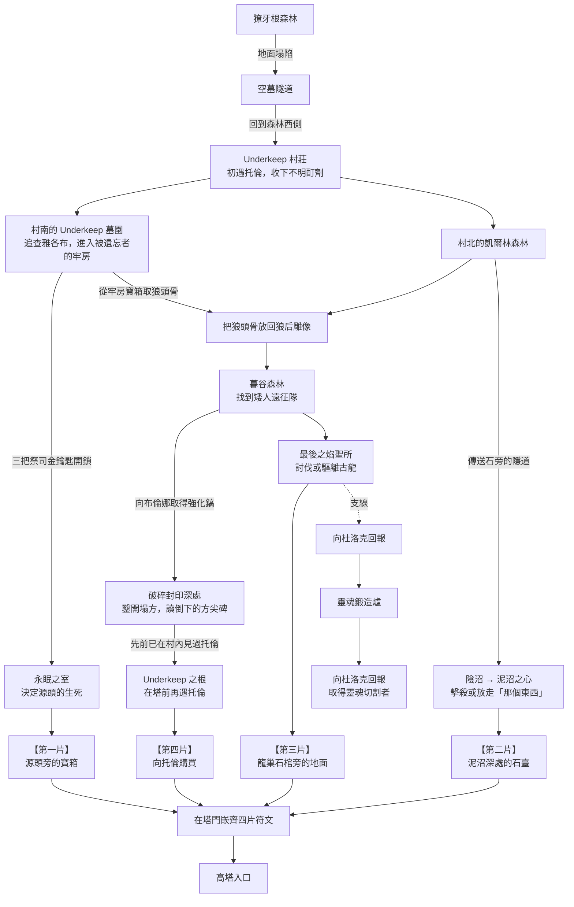
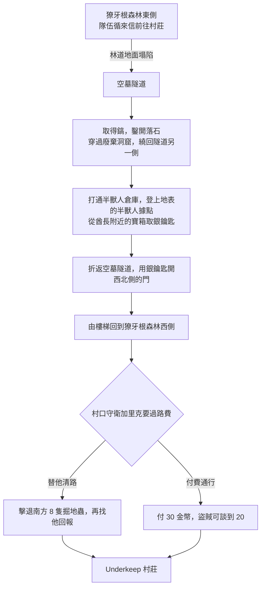
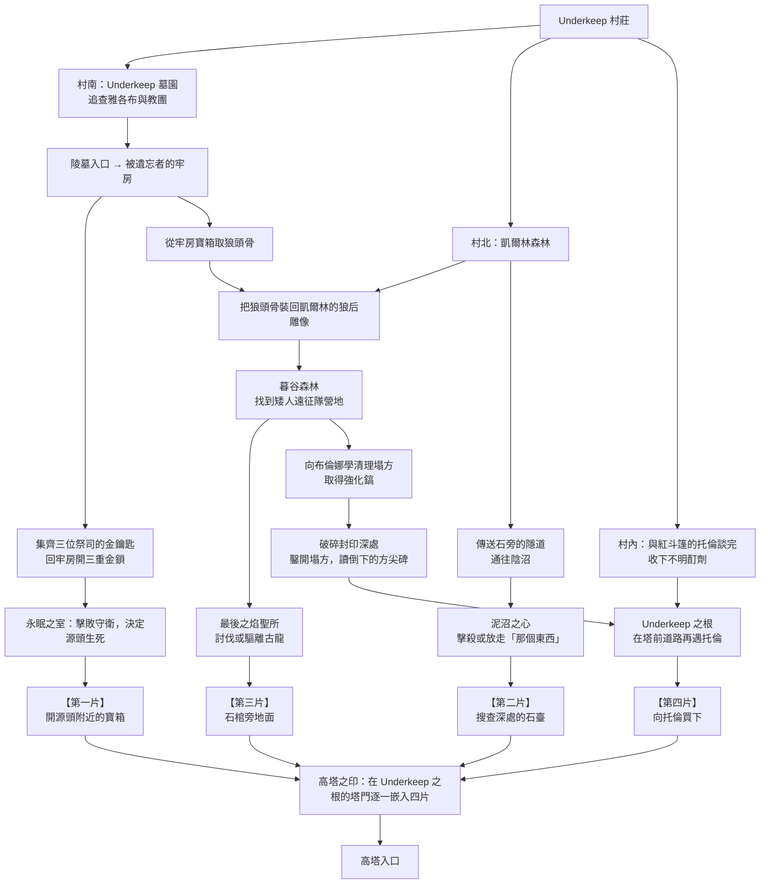
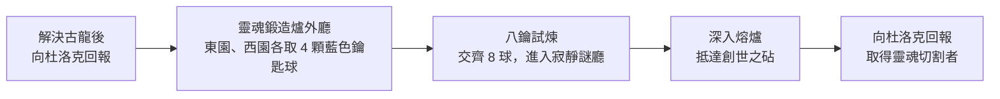
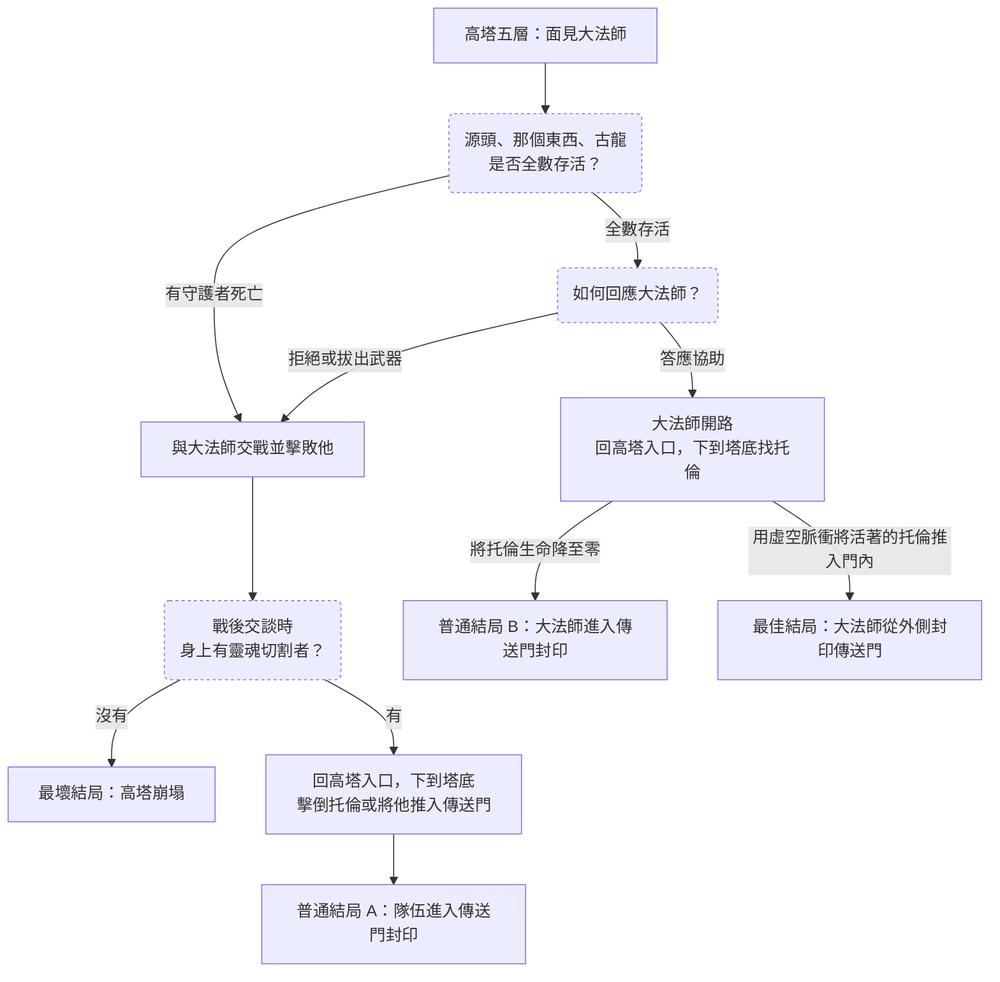

# Underkeep 劇情流程圖

## 主線總覽

**從獠牙根森林出發，隊伍得先落入空墓隧道，找到通往森林西側的出口，才能抵達 Underkeep 村莊。** 進村後，失蹤的矮人遠征隊把故事引向暮谷森林，雅各布的下落則把隊伍引向南方墓園。兩條線在一件看似無關的物品上交會：墓園地下的狼頭骨能打開通往矮人營地的路。

## 一、獠牙根森林 → 空墓隧道 → Underkeep 村莊

鼠巢的樓梯會回到森林東側的起點一帶。要去村莊，請走空墓隧道銀鎖後方的西側樓梯。回到地表後可先搜雅各布的小屋，把他留下的信帶給村裡的凱勒巴。[銀鑰匙寶箱](https://catchtest.github.io/UnderkeepGameArchive/#Starting_forest@521) · [隧道西側樓梯](https://catchtest.github.io/UnderkeepGameArchive/#Mines_under_forest@45) · [Into Indie Games 森林攻略](https://intoindiegames.com/walkthroughs/underkeep-walkthrough-part-1-crossing-the-fangroot-forest/)

## 二、從村莊追查四個符文片段

村長奧爾登與店主知道矮人遠征隊往西去了。想追上他們，可以先去墓園拿狼頭骨，再從村北進凱爾林森林。圖中的第一至第四是碎片名稱。沿箭頭看各地的開路條件，四條路線可以交錯進行。

| 碎片與位置 | 推動劇情的選擇 |
| --- | --- |
| [第一片 · 永眠之室寶箱（5, -2）](https://catchtest.github.io/UnderkeepGameArchive/#Mausoleum_3_2@335) | 凱勒巴的「南方之影」帶你到牢房救雅各布，接續「源頭之心」。進陵墓可解墓碑暗語、走側門或與教徒戰鬥。擊敗馬爾瑟里昂、塔爾裡克、澤瑞西克，用三把金鑰匙開路。選擇讓源頭活著會讓「源頭之心」顯示失敗，仍可開箱取片，並保住一名守護者。 |
| [第二片 · 泥沼之心石臺（-13, 13）](https://catchtest.github.io/UnderkeepGameArchive/#Swamp_Dungeon1@90) | 在陰沼遇到迷霧擋路，可救下格爾格拉後回去請他帶路。想保住「那個東西」，先到根墓摧毀四條觸手根，再回泥沼之心打完觸手階段，選「讓這生物離開。」和平與討伐兩條路都能取片。 |
| [第三片 · 最後之焰聖所地面（4, -59）](https://catchtest.github.io/UnderkeepGameArchive/#Dragon_den@479) | 狼頭骨在[被遺忘者的牢房（12, 7）](https://catchtest.github.io/UnderkeepGameArchive/#Mausoleum_2@135)。到了矮人營地，可向守衛報出「杜洛克、祭司」入內。想保住古龍，先答應杜洛克的「山之心」，加入科爾的遠征，在三處布置炸藥時都勸阻他，最後破壞石柱逼龍離巢。離開前記得撿碎片。 |
| [第四片 · 托倫（32, -37）](https://catchtest.github.io/UnderkeepGameArchive/#Underkeep_Surroundings@977) | 村內初遇要聊到「問問北方有什麼」，讓托倫交出酊劑。到了地下，要實際調查[倒下的方尖碑](https://catchtest.github.io/UnderkeepGameArchive/#Surroundings_Cave@686)，再回塔前找他買。即使尚未接「西方結界」，調查此碑也算數。 |

**方尖碑與塔門各自有一組「四個」。** 凱勒巴要四處方尖碑的符文抄本，交齊給傳送石。塔門要上表的四個實體片段。Into Indie Games 走的是抄齊四碑後再購買的路線。遊戲的塔外地圖事件檢查村內初遇（`first_meet_torren`），搭配讀過地下第一碑（`obelisk_one_visited` 或 `obelisk_one_visited_no_quest`）。兩項達成就能交易，原價 300 金幣，盜賊議價後付 250。[塔門四槽](https://catchtest.github.io/UnderkeepGameArchive/#Underkeep_Surroundings@459) · [Into Indie Games 四片位置](https://intoindiegames.com/walkthroughs/underkeep-walkthrough-part-6-ascending-the-underkeep-tower/)

布偶、五朵蘑菇與失蹤礦工都有各自的回報和後續，想先進塔可留待之後處理。矮人遠征則值得繼續追：它除了通往第三片，也能帶回影響結局的武器。[任務與獎勵](scripts/data/guide/quests.js) · [Into Indie Games 矮人遠征攻略](https://intoindiegames.com/walkthroughs/underkeep-walkthrough-part-4-finding-the-dwarven-expedition-and-hunting-the-dragon/)

## 三、入塔前的選擇：靈魂切割者

靈魂切割者決定與大法師交戰後能否繼續下塔，也讓隊員能在最終戰使用「虛空脈衝」。想保留最多結局選項，可在三名守護者皆存活、斧頭已到手時，於塔頂交談前存檔。[八鑰試煉的封印門](https://catchtest.github.io/UnderkeepGameArchive/#West_Dungeon_1@289) · [結局路線](images/ending-flow.svg)

## 四、高塔入口之後（含結局劇透）

穿過一層的踏板與暗影試煉，經二層及其腐化區域、三層畫廊和四層符文機關，到五層見大法師。此時才揭曉塔下封著一道傳送門：先前賣碎片給隊伍的托倫企圖打開它，而三名守護者的生死決定大法師是否願意聽你說話。[高塔入口](https://catchtest.github.io/UnderkeepGameArchive/#Tower_Level1) · [塔頂會面](https://catchtest.github.io/UnderkeepGameArchive/#Tower_Level5@3)

要觸發最後一條分支，由**力量至少 8** 的隊員裝備靈魂切割者，等托倫站到傳送門前，再用「虛空脈衝」把他推上感應格 **（-1, -12）**。直接用斧頭打到生命歸零，會走擊倒托倫的分支。[塔底傳送門事件](https://catchtest.github.io/UnderkeepGameArchive/#Undertower@160)
