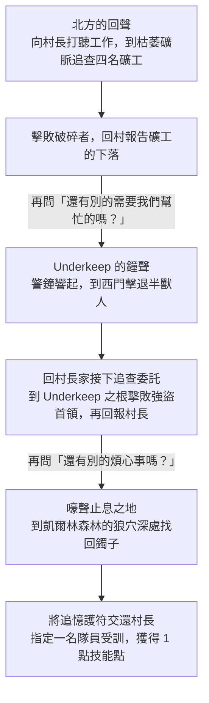
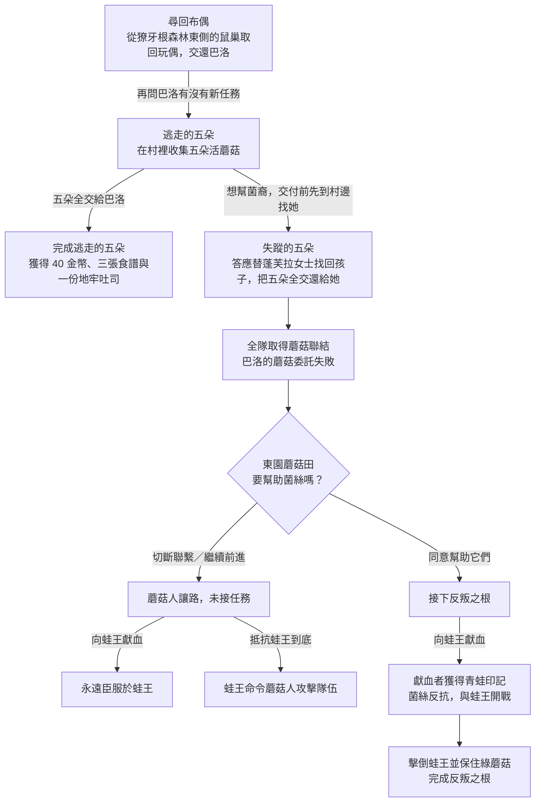
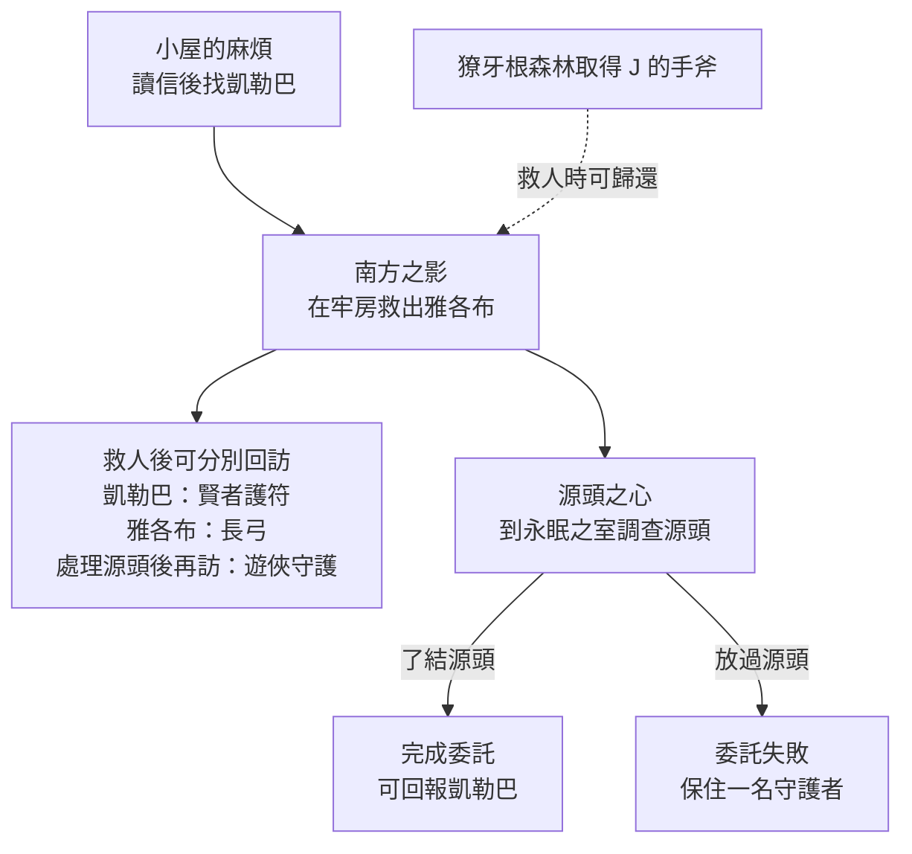
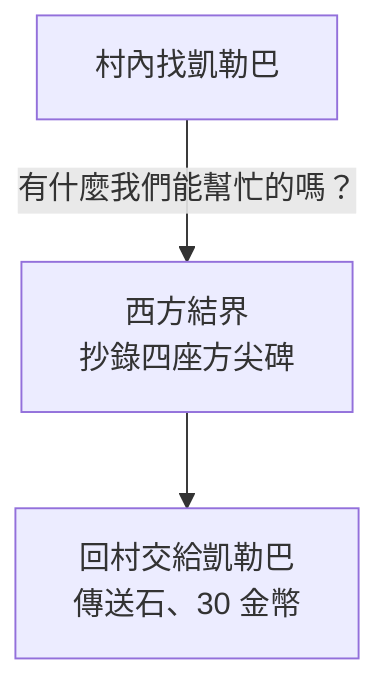
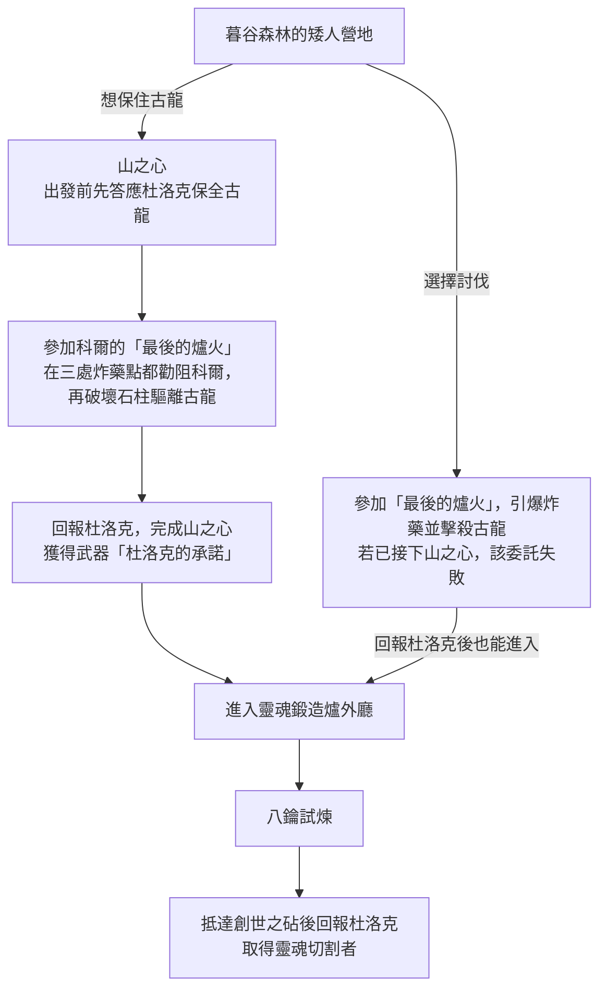

# Underkeep 可選支線任務流程圖

各條支線可以穿插進行。沿箭頭讀，就能看到下一個任務何時開放；同一處分出的箭頭會標明是二選一，還是兩件都能做。

## 村長奧爾登的三個委託

第一個委託回報時，說實話或說謊都能接到第二個。若探索時已擊敗強盜首領，守住西門後便可直接向村長回報，省去再跑營地的路。[村長的任務對話](https://catchtest.github.io/UnderkeepGameArchive/#Village_of_Underkeep@529)

## 巴洛、五朵蘑菇與東園的蛙王

面見蛙王時，隊伍中要有**法師、血法師或蛞蝓人**才能接納心靈感應。法師或血法師選「向它敞開心思。」，蛞蝓人選「讓它進來。」，接著走近噴泉獻血。若一路抵抗到最後、拒絕獻血，蛙王會命令蘑菇人攻擊隊伍。[蛙王的對話](https://catchtest.github.io/UnderkeepGameArchive/#East_Garden@199)

想救菌群，要在村裡把五朵蘑菇還給蓬芙拉女士，到了東園再明確答應幫助菌絲。只有蘑菇聯結、跳過蘑菇田直接獻血，仍會屈服於蛙王。反叛時，獻血隊員的青蛙印記會永久增加 25% 毒素抗性、免疫疾病，並降低 10% 火焰抗性。[蓬芙拉女士](https://catchtest.github.io/UnderkeepGameArchive/#Village_of_Underkeep@1060) · [東園蘑菇田](https://catchtest.github.io/UnderkeepGameArchive/#East_Garden@193) · [蛙王戰後事件](https://catchtest.github.io/UnderkeepGameArchive/#East_Garden@957)

## 雅各布、凱勒巴與源頭

- **牢房裡的手斧**：先到森林開寶箱。放雅各布下來可得 600 XP，趁他離開前選「問斧頭的事」，歸還手斧再得 400 XP。[手斧寶箱](https://catchtest.github.io/UnderkeepGameArchive/#Starting_forest@551) · [牢房對話](https://catchtest.github.io/UnderkeepGameArchive/#Mausoleum_2@101)
- **回村找凱勒巴**：回報雅各布生還，取得賢者護符與 1,000 XP。若已讀過小屋的信，即使先救人、再初次拜訪凱勒巴，也能直接回報。[村內的凱勒巴](https://catchtest.github.io/UnderkeepGameArchive/#Village_of_Underkeep@250)
- **回森林找雅各布**：首次回訪小屋旁（-14, -40）就能拿到雅各布的長弓。處理源頭後向他回報，再領取遊俠守護、15 金幣與 120 XP。[小屋旁的雅各布](https://catchtest.github.io/UnderkeepGameArchive/#Starting_forest@1819)

## 凱勒巴的西方結界

第一次見凱勒巴就能接，可與尋找雅各布同時進行。一座斷碑位於「破碎封印深處」，另外三座在「Underkeep 之根」的德魯伊林地、隱密空地與半獸人營地。[凱勒巴的委託](https://catchtest.github.io/UnderkeepGameArchive/#Village_of_Underkeep@250)

## 矮人遠征、古龍與靈魂鍛造爐

已有蘑菇聯結，可在鍛造爐東園接「反叛之根」。[東園蘑菇田](https://catchtest.github.io/UnderkeepGameArchive/#East_Garden@193)

## 沿途可接的其他支線

| 任務 | 從哪裡開始 | 步驟與時機 |
| --- | --- | --- |
| 怪物過路費 | 獠牙根森林的村口守衛加里克 | 接下委託，清除南方小路的 8 隻掘地蟲，再回報進村。也可當場付 30 金幣通行，有盜賊可談到 20。 |
| 蠻族之心 | 村裡的羅南 | 在獠牙根森林西側的扭曲枯樹旁找回頭盔，交給羅南即可開啟武器店。進村前先撿到頭盔也能直接交付。 |
| 倒下的石頭 | Underkeep 之根的德魯伊林地 | 替德魯伊查明方尖碑倒塌的原因，再回林地報告。與「西方結界」會走到同一座斷碑，兩份委託各自回報。若與德魯伊敵對，便無法回報。 |
| 石下之血 | 墓園的陵墓正門 | 解開石標暗語「守望者之血仍在滋養根系」，回正門說出口令。想先進陵墓也可走側門，或直接與守衛交戰。 |
| 大概不是個好主意 | 陵墓密室的五芒星 | 想招募伊克薩里昂，就保留法陣、找到束縛卷軸，再回來召喚並擊敗他。他會在陵墓裡暫時同行。當場破壞法陣會結束召喚路線。 |
| 又見格爾格拉／霧中迷宮 | 陰沼的藏身處與迷霧入口 | 救下被樹怪追趕的格爾格拉，並到迷霧入口查看受阻的道路。兩件事都做過後，回藏身處請他帶路，跟他走到出口即可一起完成兩項任務。 |
| 絕望之酒 | 暮谷森林矮人營地的布倫娜 | 替布倫娜收集 10 朵綠麥角菇，交付可得 50 金幣。 |
| 鐵與灰燼 | 暮谷森林矮人營地的布倫娜 | 拿月鋼礦石請她辨認，再付費打造裝備。首次鍛造即完成。 |
| 燃燒兩次的光 | 暮谷森林白樺林的提燈 | 先保住提燈，到燒焦十字架旁的孤墳召喚看守，讓它跟著隊伍回白樺林。抵達後可打碎提燈釋放雙方，或擊敗看守；途中殺死看守會失去讓靈魂安息的機會。 |

開路與收集符文的「凱爾林的狼之女王」、「碎片的代價」、「高塔之印」見主線總覽。「最後的爐火」在本圖列出兩種處理方式，方便對照「山之心」與鍛造爐的開放時機。[主線總覽](images/story-flow.svg) · [結局路線](images/ending-flow.svg) · [任務與獎勵資料](scripts/data/guide/quests.js)
